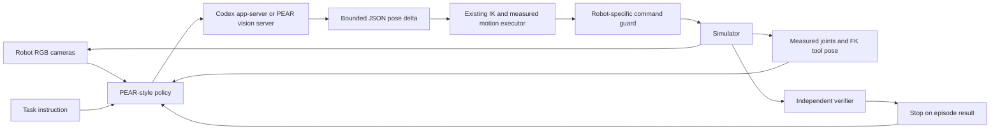

# PEAR-style runtime inference in AISLE

This experimental integration runs an observe → pose action → execute →
reobserve loop in AISLE's policy slot. It uses Codex or a vision-capable model server
with robot-specific IK and command guards. Runtime inference supports Franka
and the Adora Nano's two arms, including a local OminiX-MLX PEAR checkpoint.
PEAR training and published benchmark reproduction are not included. Nano uses
a stationary Nexus arm fixture, described below.

## What runs where



The model chooses the next Cartesian movement directly from observations.
It does not generate or execute controller code. With `--provider codex`,
Codex also makes the inner observation-to-pose decisions. With the default
`--provider chat-completions`, the configured vision server makes them.
Neither option changes AISLE's outer development/research agent. The
low-level executor uses ordinary IK and joint tracking, not another language model.

The diagram's independent task verifier applies to the Franka graph. Nano's
bring-up graph stops at a simulation time limit and does not certify task success.

The server receives only images, measured robot state, the instruction,
execution feedback, and up to four previous interactions. FK uses known
robot geometry. No simulator object coordinates or ground-truth perception
are passed to the model. The generated Franka graph selects perception rung L2;
the policy uses RGB only, even though L2 permits ordinary sensor depth.

## Prepare a simulator environment

Run from the AISLE repository. Use a separate environment to avoid changing
an environment used by another experiment:

```sh
UV_PROJECT_ENVIRONMENT=runs/pear-runtime/.venv uv sync --frozen --extra sim
uv tool run --from dora-rs-cli==1.0.1 dora --version
```

This installs the existing AISLE sim extra, including Nexus and the Genesis
package that supplies Franka assets. No new default dependencies or CUDA-only
dependencies are added by the adapter.

## Start a compatible model server

This section is for the Chat Completions provider. To use an authenticated
Codex installation without a separate model server, see the next section.

Use the upstream [PEAR deployment instructions](https://github.com/mit-han-lab/pear/blob/d604856a1b16fdccd47e22a27d4dd935e3a62014/examples/models/qwen3_8_27b_pear/deploy/README.md)
to serve an actual PEAR checkpoint, and record its revision. The AISLE
client expects an OpenAI-compatible base URL such as
`http://127.0.0.1:8000/v1` and a served model name such as `qwen3_8_27b`.
The endpoint must:

- Accept PNG data URLs in multimodal `messages` at `/chat/completions`.
- Support the requested thinking template (`enable_thinking`, `xhigh`, and
  `preserve_thinking: false`). Return the final answer in `message.content`,
  separate from reasoning, with `finish_reason: stop`.
- Produce one final fenced JSON action using the supplied embodiment's schema.

No checkpoint is bundled or automatically downloaded by AISLE. The adapter
uses an unauthenticated local/trusted endpoint; it has no API-key option.
An endpoint accepting text requests alone is insufficient. The separate base
Qwen text benchmark does not establish PEAR multimodal support. The local
OminiX backend below loads the PEAR checkpoint and processes actual images.

## Run PEAR locally with OminiX-MLX

The OminiX server is companion code outside this AISLE change. The commands
below require an OminiX checkout containing these PEAR additions; this AISLE
branch alone does not install or publish that server.
The companion OminiX checkout contains
`qwen3.5-35B-mlx/tools/README.md`, `convert_pear.py`, `pear_server.py`, and
`reference_check.py`. Follow that guide to build `pear_worker`, download
`mit-han-lab/Qwen3.8-27B-PEAR` revision
`65176e435e5fa80a059ebfafaf8215e6ad00a83e`, verify both upstream shard hashes,
and convert the language weights to affine INT4, group size 64. Vision weights
remain unquantized BF16 on disk. OminiX computes the vision and language towers
in float32; text/image embeddings retain checkpoint rounding before promotion.
The Python adapter performs preprocessing, tokenization, and HTTP transport.
It does not run a Python neural model or call Codex/remote inference.

In this workspace, the dedicated environment and model artifacts live under
`runs/nano-pear-local/`. From AISLE, start the local endpoint with:

```sh
UV_PROJECT_ENVIRONMENT=runs/nano-pear-local/.venv uv run --no-sync \
  python ../OminiX-MLX/qwen3.5-35B-mlx/tools/pear_server.py \
  --model-dir runs/nano-pear-local/pear-4bit \
  --worker ../OminiX-MLX/target/release/examples/pear_worker \
  --trace-dir runs/nano-pear-local/server-traces \
  --model-name qwen3.8-27b-pear --port 8087
```

Check `http://127.0.0.1:8087/health` for the worker status and checkpoint
provenance. Prepare a fresh Nano run in another terminal:

```sh
UV_PROJECT_ENVIRONMENT=runs/nano-pear-local/.venv uv run --no-sync \
  python -m aisle.harness.pear prepare \
  --out runs/nano-local-001 --embodiment nano --sim-engine nexus \
  --nano-urdf "$PWD/../dorobot/data/adora_nano/adora_nano.urdf" \
  --python "$PWD/runs/nano-pear-local/.venv/bin/python" \
  --endpoint http://127.0.0.1:8087/v1 --model qwen3.8-27b-pear \
  --model-revision 65176e435e5fa80a059ebfafaf8215e6ad00a83e \
  --no-thinking --max-tokens 512 --duration-s 6 --mode lockstep-eval \
  --instruction 'Inspect the RGB images, name the cube colors, and select an arm for a non-contact probe toward the red cube. Move at most 0.3 cm per action, keep the other arm and grippers still, and reobserve before choosing the next move.'

uv tool run --from dora-rs-cli==1.0.1 dora run runs/nano-local-001/dataflow.yaml
```

`--no-thinking` and `--max-tokens` are explicit HTTP inference conditions,
recorded in the graph and integration manifest. Defaults remain thinking on
and 4096 output tokens. The local check disables thinking and uses 512 tokens
to bound latency; it is not a reproduction of PEAR's published benchmark setup.
Incomplete/truncated answers cannot actuate. Physics pauses during inference
in `lockstep-eval`; this does not demonstrate real-time control.

The opt-in local integration check requires a running server with verified
PEAR provenance, the real Nano URDF, Nexus, and Dora 1.0.1:

```sh
AISLE_PEAR_TEST_OMINIX=http://127.0.0.1:8087/v1 \
AISLE_PEAR_TEST_DORA=/absolute/path/to/dora-1.0.1 \
AISLE_PEAR_TEST_PYTHON="$PWD/runs/nano-pear-local/.venv/bin/python" \
AISLE_PEAR_TEST_NANO_URDF="$PWD/../dorobot/data/adora_nano/adora_nano.urdf" \
UV_PROJECT_ENVIRONMENT=runs/nano-pear-local/.venv \
uv run --no-sync python -m pytest -q tests/accept/test_pear_ominix_runtime.py \
  --basetemp=runs/nano-local-check-001
```

Use a fresh `--basetemp`; pytest removes it before running. On success,
`ominix-validation.json` records accepted actions, measured motion, changing
RGB pixels, joint bounds, latency, model revision, and URDF hash. The separate
OminiX reference check tests image counterfactuals, image features, multimodal
positions and decoder logits against `mlx-vlm`. These are arm-runtime checks;
the Nano fixture still has no navigation, grasp/contact, placement, or task
success evaluator. They do not constitute hardware validation.

The local PEAR test passed on **2026-11-16**, on the M3 Max with 128 GiB memory,
using Studio's Nano URDF SHA-256
`a03319b78dcf338cbd64bed7bdc2062066af6f8a189cdb2cb67f9ba1e9b6b627`.
PEAR identified the blue/green/red cubes, selected the right arm, and produced
four accepted actions of at most 3 mm each. Three completed probes were visible
in subsequent observations, with 9.28 mm total measured tool displacement.
All 598 guarded commands and measured joint states stayed within tested limits;
all three camera images changed, and later requests included `reached` feedback.
Calls took **45.1, 71.8, 96.4 and 119.9 seconds** for 3, 6, 9 and 12 images.
This is a paused-simulation arm-loop result, not three-cube pickup success.

Local evidence is under `runs/nano-pear-local/validation-summary.json`,
`runs/nano-pear-local/pear-reference-002/`, and
`runs/nano-pear-local/ominix-check-001/`. The converted model uses 16.05 GB of
weights. The redundant raw shards/download cache were removed after validation;
source and derived hashes remain in the converted model's `provenance.json`.

## Use Codex as the actual RGB policy

The [Codex backend](../src/aisle/nodes/pear_codex.py) calls the authenticated
`codex app-server` through its stdio protocol. It sends inline PNGs and the
measured Nano state, receives a final pose-action JSON, then uses the same
IK, guard, measured settling, and reobservation path as the HTTP provider.
It does not execute Codex-generated controller code or return fixed actions.

Tested with **Codex CLI 0.169.0**, **`gpt-6.1-terra`**, and **medium** reasoning.
Use the simulator environment prepared above and a complete external Nano
URDF with its adjacent meshes (see the Nano setup section below).
Run `codex login status` first; the backend uses the CLI's supported login,
without copying or reading its credentials. The model runs through OpenAI's
service. Nexus and joint control run on the local Mac; this is not local MLX
inference or the PEAR-trained Qwen checkpoint.

For the Nano, use its complete URDF and meshes and the simulator Python
environment described below. Pick a new output directory:

```sh
runs/pear-runtime/.venv/bin/python -m aisle.harness.pear prepare \
  --out runs/nano-codex-001 \
  --provider codex \
  --model gpt-6.1-terra \
  --reasoning-effort medium \
  --embodiment nano \
  --nano-urdf /absolute/path/to/adora_nano/adora_nano.urdf \
  --sim-engine nexus \
  --mode lockstep-eval \
  --duration-s 6 \
  --python "$PWD/runs/pear-runtime/.venv/bin/python" \
  --instruction 'Inspect the RGB views and identify the cube colors. Choose the arm best placed to approach the red cube. Make non-contact probes of at most 0.3 cm, compare fresh images and measured tool state after each move, and refine the next move. Keep the other arm and both grippers still.'

uv tool run --from dora-rs-cli==1.0.1 dora run runs/nano-codex-001/dataflow.yaml
```

`--codex-executable` selects a specific installed CLI. `--endpoint` is not
needed for this provider. The CLI must support the experimental
`thread/start.environments` and `turn/start.environments` API.

Each request starts a fresh ephemeral thread in a temporary directory outside
the repository, with `environments: []`, no dynamic tools, and read-only / never
approval settings. Shell, web, apps, plugins, multi-agent tools, hooks, project
instructions, and memory injection are disabled by per-process configuration.
Configured MCP servers are disabled, and their inventory is checked before
inference. Unexpected tool activity, approvals, a changed model identity,
cross-thread replies, and incomplete turns fail closed. Global Codex settings
are not edited. Only final assistant text is consumed; reasoning output is not
used as a robot action.

The trace records the returned model identity, CLI user agent, thread/turn IDs,
token usage, wall-clock latency, input PNGs, final answer, and controller feedback.
Codex has no seed parameter in this interface: the seed is recorded as unsupported.
This is a non-attesting experiment, not a deterministic benchmark result or a
pinned checkpoint evaluation.

The live test on 2026-11-16 identified blue, green, and red cubes, selected
the right arm, and issued a 3 mm forward probe. The next request included fresh
RGB, `reached` feedback, and a measured 3.02 mm forward displacement; Codex then
chose another forward probe. The final six-second simulation run accepted three
model actions and produced 598 guarded joint commands; two completed probes
were measured in the third observation (6.03 mm forward). Calls took 5.3–6.8 seconds
with physics paused during inference. This verifies an actual model-driven
feedback loop, **not cube contact, grasping, placement, or navigation**.

Reproduce the opt-in live check (uses authenticated model requests):

```sh
AISLE_PEAR_TEST_CODEX=1 \
AISLE_PEAR_TEST_DORA=/absolute/path/to/dora-1.0.1 \
AISLE_PEAR_TEST_PYTHON="$PWD/runs/pear-runtime/.venv/bin/python" \
AISLE_PEAR_TEST_NANO_URDF=/absolute/path/to/adora_nano/adora_nano.urdf \
UV_PROJECT_ENVIRONMENT=runs/pear-runtime/.venv \
uv run --no-sync python -m pytest -q tests/accept/test_pear_codex_runtime.py \
  --basetemp=runs/nano-codex-check-001
```

Use a fresh `--basetemp`: pytest removes that directory before a run. Without
the opt-in variable, this check skips. Its `codex-validation.json` summarizes
the actual model, guarded motion, feedback, and explicit task-success limits.

## Generate and run a new graph

After starting the server, choose a new output directory for every run:

```sh
runs/pear-runtime/.venv/bin/python -m aisle.harness.pear prepare \
  --out runs/pear-franka-001 \
  --endpoint http://127.0.0.1:8000/v1 \
  --model qwen3_8_27b \
  --model-revision YOUR_CHECKPOINT_REVISION \
  --sim-engine nexus \
  --mode lockstep-eval \
  --python "$PWD/runs/pear-runtime/.venv/bin/python"

uv tool run --from dora-rs-cli==1.0.1 dora run runs/pear-franka-001/dataflow.yaml
```

`prepare` performs configuration validation only; it does not contact the
server. It emits JSON, refuses to overwrite an existing run directory, and
creates a new graph and turn plan. The initial graph runs the existing T1
Franka scene with seed 0 and an independent oracle verifier. It is not the
Nano living-room scene, and it has no mobile-base controller.

This is a **non-attesting bring-up graph**, run directly with Dora.
`pear-policy` is deliberately absent from the skill registry. Normal
`harness validate`/`harness rollout` acceptance requires a registered skill
and measured evalcard; this helper does not bypass or weaken those checks.
Interpreter-wrapper paths also belong to bring-up, not registry acceptance.

## Choose the inference condition

| Mode | Behavior | Interpretation |
| --- | --- | --- |
| `lockstep-eval` | Wait for the server inside an AISLE turn; physics waits for closure. | Tests observation/action logic while simulation is paused during inference. |
| `async-live` | Keep processing turns with at most one background request; refuse late or invalidated replies. | Exposes model latency relative to advancing simulation time. |

Both generated graphs keep AISLE's turn barrier. `async-live` does not imply
that simulation time equals wall time, or that the model meets real-robot
latency requirements. Simulation replies older than 500 ms are rejected;
the arm must also remain within 0.01 rad/m of the observed joint vector.

The inference timeout is 180 s, with a 210 s turn watchdog in the generated graph.
The guard's existing episode **wall-time budget remains unchanged**, so a
slow model can exhaust that budget even in `lockstep-eval`. The existing
episode simulator timeout is 30 s. A completed HTTP request is not evidence
that the action was accepted or that the task succeeded.

## Franka action contract and execution

The final model answer ends with one fenced JSON block:

````text
```json
{"arm":{"x":0,"y":0,"z":0.2,"roll":0,"pitch":0,"yaw":0},"gripper":{"width":0}}
```
````

This requests a 2 mm upward move from the observed tool position. Translation
uses the robot-base frame and centimeters; angles are additive fixed-axis
XYZ roll/pitch/yaw increments in radians. Width is a centimeter delta:
positive opens, negative closes, zero holds. Limits per action are a 5 cm
translation norm, 0.35 rad rotation-delta norm, and 2 cm width change. The
Franka gripper is bounded to 0–8 cm. These gripper semantics are specific to
this adapter, not PEAR's SO101 or Nano semantics.

The executor interpolates reachable poses with existing IK, checks joint
and workspace limits, streams small joint changes, waits for measured arm
settling, then moves the gripper. Commands still traverse `budget-guard`.
Missing/stale observations, malformed responses, new goals, and resets
prevent old actions from executing. Motion execution has a 10 s simulator
timeout; at most 64 requests are made per goal, at least 1 s of simulator
time apart. These limits are engineering defaults, not tuned PEAR results.

The guard and IK do not supply a visual collision planner. Reaching an arm
pose does not establish contact or a grasp; task success is the independent
verifier's decision. This adapter is for simulation, not physical deployment.

## Inspect evidence

Each generated run directory contains:

- `integration.json`: model/revision, condition, simulator, and explicit
  `attested: false` / `registered_skill: false` status.
- `dataflow.yaml` and `turn-plan.json`: exact generated wiring.
- `traces/<epoch>-<request>/`: actual input PNGs and `request.json`, including
  the multimodal messages sent to the server and the originating goal ID.
- `traces/events.jsonl`: request hashes, final replies, token usage,
  acceptance/rejection feedback, and serializable contract metadata.
- `episodes.jsonl`: independent episode results when the rollout finishes.

`model_reply.accepted` means the controller admitted a bounded motion; it
does not mean the motion completed or the task succeeded. Trace metadata is
whitelisted; native Dora timestamps and arbitrary metadata are not forwarded
to the model or blindly serialized. A declared model revision is provenance
provided by the operator, not a cryptographic checkpoint attestation.

## Tests and present limits

```sh
UV_PROJECT_ENVIRONMENT=runs/pear-runtime/.venv \
uv run --no-sync python -m pytest -q tests/unit/test_pear_*.py

AISLE_PEAR_TEST_DORA=/absolute/path/to/dora-1.0.1 \
AISLE_PEAR_TEST_PYTHON="$PWD/runs/pear-runtime/.venv/bin/python" \
UV_PROJECT_ENVIRONMENT=runs/pear-runtime/.venv \
uv run --no-sync python -m pytest -q tests/accept/test_pear_runtime.py
```

The acceptance suite runs a real local HTTP server and Dora processes with
the existing IK, guard, and turn barrier. Its server emits a fixed 2 mm move;
its world feeds guarded commands back as measured joints and supplies tiny
synthetic RGB images. It checks that a second request observes the changed
pose in both inference modes. Without the two environment variables, the
HTTP test runs and the Dora cases skip.

A 700 ms stand-in response delay also checks the timing distinction: the
lockstep case can execute against its paused observation, while the advancing
asynchronous case rejects the stale replies and emits no motion commands.

These Franka transport tests do not evaluate PEAR weights, camera understanding,
contact physics, or success on the generated Nexus scene. The additional Nano
test below runs real Nexus physics and cameras, with a stand-in model. RL
training and registry promotion remain separate work.
See [ADR-74](decisions/ADR-74.md) for the design and upstream references.

## Adora Nano: two arms and three RGB cameras

The Nano adapter loads the real URDF's origins, axes, link lengths, angular
limits and effort ceilings. Each arm has **five motion joints plus one hinged
gripper**. It never uses Franka geometry or treats the arms as scaled SO100s.
The shared policy lifecycle handles all three Nano RGB inputs (`head`,
`left_wrist`, `right_wrist`) and the measured 17-channel joint vector.

The kinematics reference in `assets/adora_nano/` is pinned to Studio revision
[`f218095`](https://github.com/dorobot-org/dorobot-studio/tree/f21809507e81e9c80ccee6fa0853c73c7a9423a1/data/adora_nano).
Its URDF SHA-256 is
`342da414bca32361ad6be12e76ac769289dc56e382ad44e811361809c5e48529`.
The local Studio branch inspected during implementation has different left-arm
axes/transforms. The adapter accepts the complete Nano URDF you explicitly
provide; every generated graph binds its hash and refuses a changed model.
The model's relative mesh paths must resolve beside that URDF.

For a minimal Nano environment (no Franka/Genesis assets are needed):

```sh
uv venv --python 3.13 runs/pear-nano-runtime/.venv
uv pip install --python runs/pear-nano-runtime/.venv/bin/python \
  -e . dora-rs==1.0.1 dimforge-nexus3d==0.2.1 'pytest>=8'

runs/pear-nano-runtime/.venv/bin/python -m aisle.harness.pear prepare \
  --embodiment nano \
  --nano-urdf /absolute/path/to/adora_nano/adora_nano.urdf \
  --out runs/pear-nano-001 \
  --endpoint http://127.0.0.1:8000/v1 \
  --model qwen3_8_27b \
  --model-revision YOUR_CHECKPOINT_REVISION \
  --mode lockstep-eval \
  --instruction "Observe the three cubes and raise both tools slightly." \
  --duration-s 30 \
  --python "$PWD/runs/pear-nano-runtime/.venv/bin/python"

uv tool run --from dora-rs-cli==1.0.1 dora run runs/pear-nano-001/dataflow.yaml
```

This graph contains `nano-sim → pear-policy → nano-guard → nano-sim` and the
real AISLE turn barrier. Its independent guard checks joint limits, command
velocity, tracking distance, tool workspace and separation, and held base/head
coordinates. Repeated timestamps cannot spend the velocity allowance twice.
It uses an experimental Nano guard rather than a falsely labeled Franka guard;
it remains unregistered and non-attesting.

Nano's action schema is:

```json
{
  "left_arm":  {"x": 0, "y": 0, "z": 0.2, "pitch": 0, "roll": 0},
  "right_arm": {"x": 0, "y": 0, "z": 0,   "pitch": 0, "roll": 0},
  "left_gripper":  {"angle": 0},
  "right_gripper": {"angle": 0}
}
```

All values are increments. XYZ uses centimeters in `base_link`; the target
points are the actual URDF `*_tool_mount` origins. Pitch is the sum of the
three pitch-joint coordinates, and roll is joint 5, both in radians. These
are five controllable robot coordinates, **not six independent world-frame
pose components**. The observed FK Euler orientation is reported separately.
Gripper `angle` is an angular increment in radians, bounded to ±0.1 per
action and the URDF limits. No jaw-width or open/close calibration is invented.
The mounting-frame origin is not a calibrated fingertip contact center.

The simulator retains the actual arm/head geometry, motors, meshes, and URDF
effort ceilings. It generates a local `nano-arm-fixture.urdf` that fixes the
root and constrains the three wheel joints at zero. This explicit fixture
avoids unstable continuous-wheel contacts observed with a fixed root in the
current Nexus solver. The floor height comes from the actual wheel collider
vertices. It is **stationary arm validation**, not a mobile Nano dynamics test.
Head/wrist optical transforms and lens parameters are nominal simulation
assumptions; the URDF contains housings, not calibrated optical frames.

The run retains `nano-scene.json` with the model/fixture hashes and constraints,
`nano-runtime.jsonl` with measured joints, guarded commands and guard corrections,
and the normal PNG/request/reply traces. At `--duration-s` it stops cleanly with
`bringup_time_limit`; that event explicitly reports no evaluated task success.

The live Nano check uses Nexus/Metal, real rendered RGB, real joint feedback,
URDF-based IK, the independent guard and a local HTTP stand-in that requests
2 mm tool lifts. It verifies both arms move and the next request reflects that
motion, while wheel/head state remains bounded:

```sh
AISLE_PEAR_TEST_DORA=/absolute/path/to/dora-1.0.1 \
AISLE_PEAR_TEST_PYTHON="$PWD/runs/pear-nano-runtime/.venv/bin/python" \
AISLE_PEAR_TEST_NANO_URDF=/absolute/path/to/adora_nano/adora_nano.urdf \
UV_PROJECT_ENVIRONMENT=runs/pear-nano-runtime/.venv \
uv run --no-sync python -m pytest -q tests/accept/test_pear_nano_runtime.py
```

The local PEAR checks above cover image ingestion, small arm actions and fresh
feedback. Cube grasp/contact success, calibrated gripper control, mobile
navigation, and physical hardware operation remain unvalidated.
